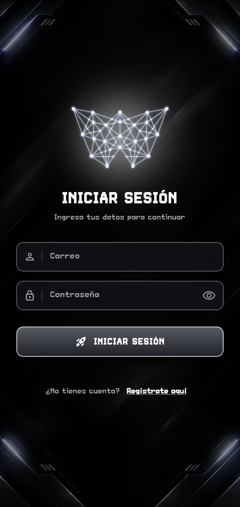
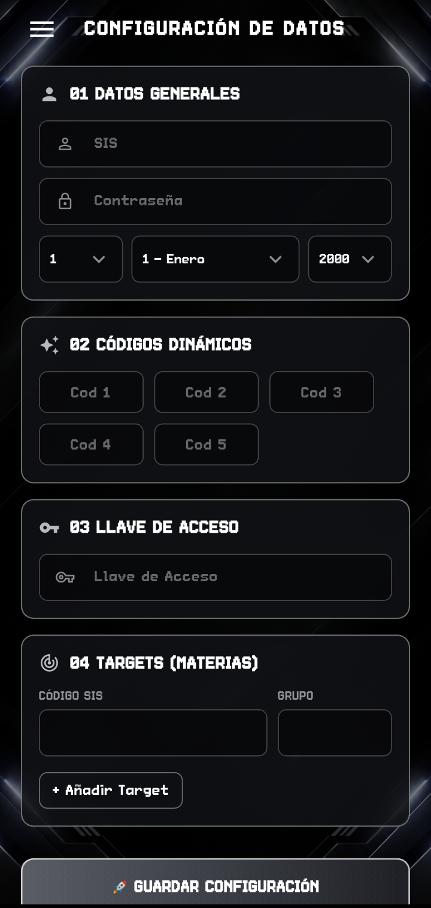
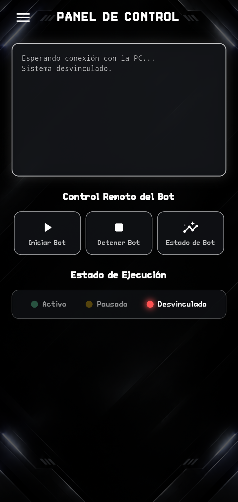

  <table>
    <tr>
      <td align="center"><b>Pantalla de Ingreso</b></td>
      <td align="center"><b>Configuración de Datos</b></td>
      <td align="center"><b>Panel de Control Remoto</b></td>
    </tr>
    <tr>
      <td></td>
      <td></td>
      <td></td>
    </tr>
  </table>

